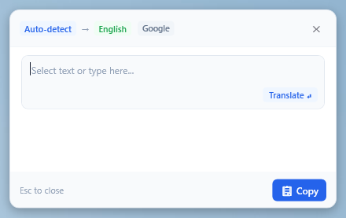
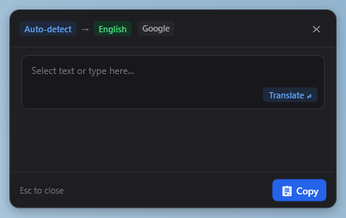
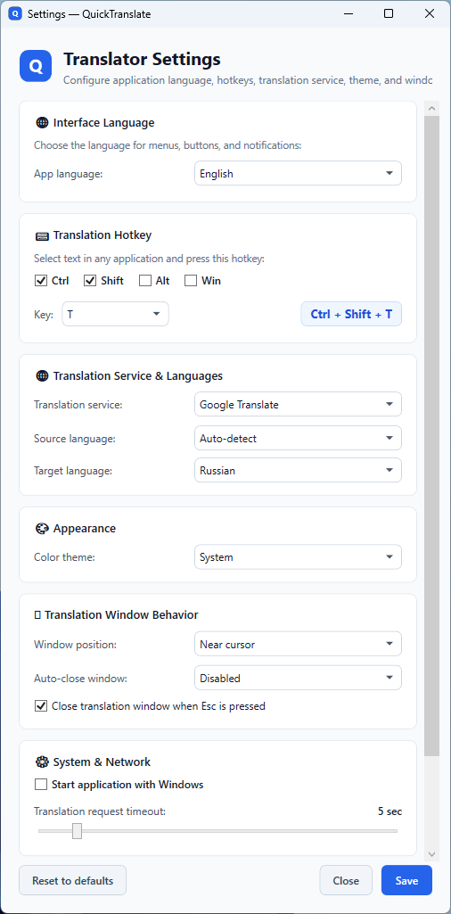

# QuickTranslate

> **Select. Press. Translate.**

A fast, lightweight Windows desktop app that lets you instantly translate selected text from any program with a keyboard shortcut.

**English** | [Русский](README.ru.md)

---

## Overview

**QuickTranslate** lives quietly in your Windows system tray. Whenever you come across unfamiliar text — in a web browser, PDF book, office document, game, or chat — simply select it and press `Ctrl + Shift + T`. A clean, modern popup appears instantly beside your cursor with the translation.

No need to switch windows, open browser tabs, or copy-paste back and forth.

---

## Screenshots

| Light Theme | Dark Theme |
|:---:|:---:|
|  |  |

### Settings Window



---

## Why QuickTranslate?

- ⚡ **Instant Translation Everywhere**: Works across all Windows applications. Select text, press the shortcut, and read the translation immediately.
- 🌐 **Choice of Translation Engines**: Switch between **Google Translate**, **Yandex Translate**, and **MyMemory** at any time.
- 📋 **Protects Your Clipboard**: Unlike basic tools, QuickTranslate will not overwrite or erase whatever you already had copied in your clipboard.
- ✍️ **Manual Input Mode**: If you press the hotkey without selecting anything (or click the tray icon), the popup opens ready for you to type or paste text manually.
- 🎨 **Windows 11 Fluent Design**: Looks right at home in modern Windows with smooth animations, rounded corners, and native **Light** and **Dark** themes that can follow your system theme automatically.
- 🌍 **Multilingual Interface**: Full interface support for 6 languages (**English**, **Русский**, **Español**, **Deutsch**, **Français**, and **中文**) plus a System Auto-detect mode.
- 🗣️ **14 Target Languages**: Automatic source language detection and translation into 14 languages: English, Russian, German, French, Spanish, Italian, Chinese, Japanese, Korean, Portuguese, Turkish, Polish, Ukrainian, and Arabic.
- 🪟 **Smart Popup**:
  - Pops up right where you are reading (or centered on screen).
  - Copies translation to clipboard in a single click (with visual "Copied!" feedback).
  - Closes with `Esc`, by clicking outside the window, or with an optional auto-close timer (5–30 sec) that automatically pauses while your mouse is over it.
- 🪶 **Low Resource Usage**: Designed to run quietly in the background with modest memory consumption (~15–25 MB) and minimal CPU usage when idle.
- 🔒 **Privacy & Transparency**: Text is sent directly to your chosen provider over secure HTTPS solely to perform the translation and is **never saved, logged, or stored by the app**.
- 🚀 **Zero Installation Hassle**: Portable single-file executable. Runs without requiring administrator rights and without installing extra runtimes.

---

## Download & Installation

1. Go to the [Releases](https://github.com/egladkov/QuickTranslate/releases) page and download `QuickTranslate.exe`.
2. Move `QuickTranslate.exe` to any folder you like (for example, `C:\Tools\` or your personal apps folder).
3. Double-click `QuickTranslate.exe` to start.
4. The app will minimize to the notification area (system tray near the clock) with a **Q** icon.

> **Tip**: If you want QuickTranslate to be ready every time you turn on your PC, open **Settings** and check **Start with Windows**.

---

## How to Use

### 1. Translate Selected Text
1. Highlight any word, phrase, or paragraph in any program (browser, PDF, Word, Telegram, etc.).
2. Press **`Ctrl + Shift + T`** (default shortcut).
3. The translation popup will appear next to your mouse cursor.

### 2. Translate by Typing Manually
1. Press **`Ctrl + Shift + T`** when no text is selected (or right-click the **Q** icon in the tray and select **Show translation window**).
2. Type or paste your text into the box and press **Enter** (or click **Translate**).

### 3. Popup Controls
- **Copy**: Click the **Copy** button or click directly on the translated text.
- **Move**: Drag the popup by its top header to place it anywhere on screen.
- **Close**: Press `Esc`, click the **✕** button, or click anywhere outside.

### 4. System Tray Menu
Right-click the **Q** icon in the system tray:
- **Settings**: Customize shortcut keys, theme, translation service, and languages.
- **Show translation window**: Open the manual translation box.
- **Start with Windows**: Toggle autostart on or off.
- **Exit**: Close QuickTranslate completely.

---

## Settings & Customization

Open Settings by right-clicking the tray icon and choosing **Settings** (or simply launch `QuickTranslate.exe` again while it is already running).

| Setting | What it does | Default |
|---|---|---|
| **App Language** | Language of the application menus and buttons | System language |
| **Hotkey** | Keyboard shortcut used to trigger translation | `Ctrl + Shift + T` |
| **Translation Service** | Web service used for translations (Google, Yandex, MyMemory) | Google Translate |
| **Source Language** | Language of the text you are translating | Auto-detect |
| **Target Language** | Language you want the translation in | Russian |
| **Theme** | Appearance mode: System, Light, or Dark | System |
| **Window Position** | Where the popup appears: Near cursor or Center screen | Near cursor |
| **Auto-close** | Automatically close popup after 5, 10, 15, or 30 seconds of inactivity | Disabled |
| **Close on Esc** | Pressing the Escape key immediately dismisses the popup | Enabled |
| **Close on click outside** | Dismiss translation window immediately when clicking outside of it | Enabled |
| **Start with Windows** | Launch automatically when you sign in to Windows | Disabled |
| **Request Timeout** | Maximum time to wait for translation servers (2–30 seconds) | 5 seconds |

Settings are saved in `%APPDATA%\QuickTranslate\settings.json`.

---

## Privacy

- Text is sent directly to your selected translation provider (Google Translate, Yandex Translate, or MyMemory) over secure HTTPS solely to obtain the translation.
- QuickTranslate **does not store or record** your translated text: the app keeps no translation history and saves nothing to disk.
- Diagnostic logs (located in `%APPDATA%\QuickTranslate\logs\app.log`) only contain technical status messages (network connectivity, character counts, error codes). No user text is ever logged.
- The project is 100% open source — you can inspect every line of code yourself.

---

## System Requirements

- **Operating System**: Windows 10 (64-bit) or Windows 11 (64-bit).
- **Internet Connection**: Required to connect to translation services.
- **Dependencies**: None. The standalone executable includes everything needed to run.

---

## For Developers (Build from Source)

If you wish to build or modify QuickTranslate yourself:

### Prerequisites
- [.NET 10.0 SDK](https://dotnet.microsoft.com/download) (or newer)
- Windows 10/11 x64

### Build & Run Tests
```powershell
# Clone the repository
git clone https://github.com/egladkov/QuickTranslate.git
cd QuickTranslate

# Build the project
dotnet build QuickTranslate.slnx

# Run automated tests (121 tests)
dotnet test

# Publish standalone single-file EXE
dotnet publish src/QuickTranslate/QuickTranslate.csproj -c Release -o ./publish
```

The resulting `QuickTranslate.exe` will be located in the `./publish` directory.

---

## License

This project is open-source and released under the [MIT License](LICENSE).  
&copy; 2026 Eugene Gladkov.

---

## Author

- **Eugene Gladkov** — [@egladkov](https://github.com/egladkov)
