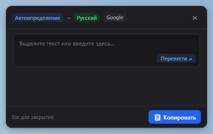
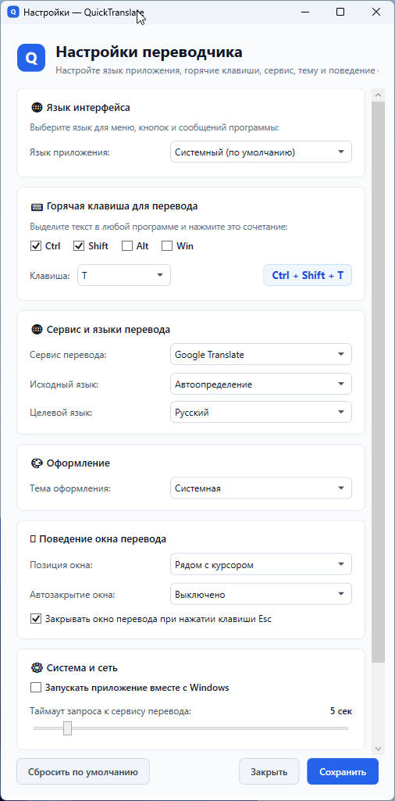

# QuickTranslate

> **Select. Press. Translate.**

Быстрое и удобное приложение для Windows, которое позволяет мгновенно переводить выделенный текст из любой программы с помощью сочетания клавиш.

[English](README.md) | **Русский**

---

## О проекте

**QuickTranslate** тихо работает в системном трее Windows (рядом с часами). Когда вы читаете статью в браузере, PDF-документ, книгу, переписываетесь в мессенджере или работаете с файлом — просто выделите незнакомый текст и нажмите сочетание клавиш **`Ctrl + Shift + T`**. Рядом с курсором мыши мгновенно появится аккуратное окно с готовым переводом.

Больше не нужно переключаться между вкладками браузера, открывать онлайн-переводчики и бесконечно копировать текст туда и обратно.

---

## Скриншоты

| Светлая тема | Тёмная тема |
|:---:|:---:|
|  |  |

### Окно настроек



---

## Почему QuickTranslate?

- ⚡ **Мгновенный перевод везде**: Работает в любых программах Windows. Выделили фрагмент, нажали клавиши — и перевод сразу перед глазами.
- 🌐 **Выбор сервиса перевода**: Переключайтесь между **Google Translate**, **Яндекс Переводчиком** и **MyMemory** в настройках в один клик.
- 📋 **Бережёт ваш буфер обмена**: В отличие от многих утилит, QuickTranslate не затирает текст, который вы скопировали ранее в буфер обмена.
- ✍️ **Режим ручного ввода**: Если нажать горячие клавиши без выделения текста (или кликнуть по иконке в трее), откроется окно с полем ввода для ручного набора или быстрой вставки.
- 🎨 **Современный стиль Windows 11**: Приятный дизайн со скруглёнными углами, поддержкой **Светлой** и **Тёмной** тем оформления, которые могут автоматически подстраиваться под системную тему Windows.
- 🌍 **Интерфейс на русском языке**: Программа полностью переведена на 6 языков (**Русский**, **English**, **Español**, **Deutsch**, **Français** и **中文**) с возможностью автоопределения языка системы.
- 🗣️ **14 языков перевода**: Автоматическое определение исходного языка и перевод на 14 языков: русский, английский, немецкий, французский, испанский, итальянский, китайский, японский, корейский, португальский, турецкий, польский, украинский и арабский.
- 🪟 **Умное всплывающее окно**:
  - Появляется прямо в месте чтения (или по центру экрана).
  - Копирование перевода в один клик (с понятной индикацией «Скопировано!»).
  - Закрывается по клику вне окна, по клавише `Esc` или по таймеру автозакрытия (5–30 секунд), который автоматически встаёт на паузу, пока на окно наведён курсор мыши.
- 🪶 **Низкое потребление ресурсов**: Приложение рассчитано на работу в фоновом режиме с небольшим расходом оперативной памяти (~15–25 МБ) и минимальной нагрузкой на процессор в состоянии простоя.
- 🔒 **Приватность и прозрачность**: Текст отправляется только выбранному провайдеру для перевода по защищённому соединению (HTTPS) и **не сохраняется приложением на диске или в логах**.
- 🚀 **Не требует сложной установки**: Портативный один файл `.exe`. Не требует прав администратора и установки дополнительных компонентов.

---

## Скачивание и запуск

1. Перейдите в раздел [Релизы (Releases)](https://github.com/egladkov/QuickTranslate/releases) и скачайте файл `QuickTranslate.exe`.
2. Поместите `QuickTranslate.exe` в любую удобную папку на компьютере (например, в `C:\Tools\` или в папку с вашими программами).
3. Запустите файл `QuickTranslate.exe` двойным кликом.
4. Программа свернётся в область уведомлений (системный трей возле часов) с иконкой **Q**.

> **Совет**: Если вы хотите, чтобы переводчик был готов к работе сразу после включения компьютера, откройте **Настройки** и включите пункт **Запускать приложение вместе с Windows**.

---

## Как пользоваться

### 1. Перевод выделенного текста
1. Выделите любое слово, фразу или целый абзац в любой программе (браузер, Word, PDF, Telegram и т. д.).
2. Нажмите сочетание клавиш **`Ctrl + Shift + T`** (по умолчанию).
3. Рядом с курсором появится всплывающее окно с автоматически определенным языком и переводом.

### 2. Перевод текста вручную
1. Нажмите **`Ctrl + Shift + T`**, если текст предварительно не был выделен (или нажмите правой кнопкой мыши по иконке **Q** в трее и выберите **Показать окно перевода**).
2. Введите или вставьте текст в поле ввода и нажмите клавишу **Enter** (или кнопку **Перевести**).

### 3. Управление всплывающим окном
- **Скопировать**: Нажмите кнопку **Копировать** или кликните прямо по блоку с переведённым текстом.
- **Переместить**: Зажмите левую кнопку мыши на верхней плашке окна и перетащите его в удобное место.
- **Закрыть**: Нажмите клавишу `Esc`, крестик **✕** в углу или кликните мышью за пределами окна.

### 4. Меню в системном трее
Кликните правой кнопкой мыши по иконке **Q** в трее:
- **Настройки**: Изменить горячую клавишу, тему, сервис и языки перевода.
- **Показать окно перевода**: Открыть окно для ручного ввода текста.
- **Запускать вместе с Windows**: Включить или отключить автозагрузку программы.
- **Выход**: Полностью завершить работу переводчика.

---

## Настройки

Окно настроек можно открыть через контекстное меню трея (*Настройки*) либо просто запустив файл `QuickTranslate.exe` ещё раз, если программа уже работает.

| Параметр | За что отвечает | По умолчанию |
|---|---|---|
| **Язык приложения** | Язык кнопок, меню и сообщений программы | Системный язык |
| **Горячая клавиша** | Сочетание клавиш для быстрого перевода | `Ctrl + Shift + T` |
| **Сервис перевода** | Провайдер перевода (Google Translate, Яндекс Переводчик, MyMemory) | Google Translate |
| **Исходный язык** | Язык текста, который вы переводите | Автоопределение |
| **Целевой язык** | Язык, на который нужно перевести текст | Русский |
| **Тема оформления** | Внешний вид: Системная, Светлая или Тёмная | Системная |
| **Позиция окна** | Где появляется окно: Рядом с курсором или По центру экрана | Рядом с курсором |
| **Автозакрытие** | Автоматически закрывать окно через 5, 10, 15 или 30 секунд | Выключено |
| **Закрывать по Esc** | Закрытие всплывающего окна перевода по нажатию клавиши Esc | Включено |
| **Закрывать при клике вне окна** | Закрытие окна перевода при клике в любое место за его пределами | Включено |
| **Запуск с Windows** | Автоматический запуск программы при входе в систему | Выключено |
| **Таймаут запроса** | Время ожидания ответа от сервера перевода (от 2 до 30 секунд) | 5 секунд |

Настройки сохраняются в папке пользователя: `%APPDATA%\QuickTranslate\settings.json`.

---

## Конфиденциальность

- Текст для перевода отправляется напрямую выбранному провайдеру (Google Translate, Яндекс Переводчик или MyMemory) по защищённому протоколу HTTPS исключительно для выполнения перевода.
- QuickTranslate **не сохраняет и не накапливает** переводимый текст: приложение не ведёт историю переводов и не записывает текст на диск.
- В технический журнал диагностики (`%APPDATA%\QuickTranslate\logs\app.log`) попадают исключительно служебные сообщения (наличие сети, длина текста в символах, коды ошибок). Сам текст пользователя никогда не попадает в логи.
- Проект имеет полностью открытый исходный код — вы можете самостоятельно проверить каждую строчку.

---

## Системные требования

- **Операционная система**: Windows 10 (64-битная) или Windows 11 (64-битная).
- **Интернет**: Требуется для связи с серверами перевода.
- **Сторонние компоненты**: Не требуются. Автономная сборка содержит всё необходимое для запуска.

---

## Для разработчиков (сборка из исходников)

Если вы хотите самостоятельно скомпилировать или доработать проект:

### Требования
- [.NET 10.0 SDK](https://dotnet.microsoft.com/download) (или новее)
- Windows 10/11 x64

### Сборка и тестирование
```powershell
# Клонировать репозиторий
git clone https://github.com/egladkov/QuickTranslate.git
cd QuickTranslate

# Собрать проект
dotnet build QuickTranslate.slnx

# Запустить автоматические тесты (121 тест)
dotnet test

# Опубликовать автономный однофайловый EXE
dotnet publish src/QuickTranslate/QuickTranslate.csproj -c Release -o ./publish
```

Собранный файл `QuickTranslate.exe` появится в папке `./publish`.

---

## Лицензия

Проект распространяется под свободной лицензией [MIT](LICENSE).  
&copy; 2026 Евгений Гладков.

---

## Автор

- **Евгений Гладков** — [@egladkov](https://github.com/egladkov)
